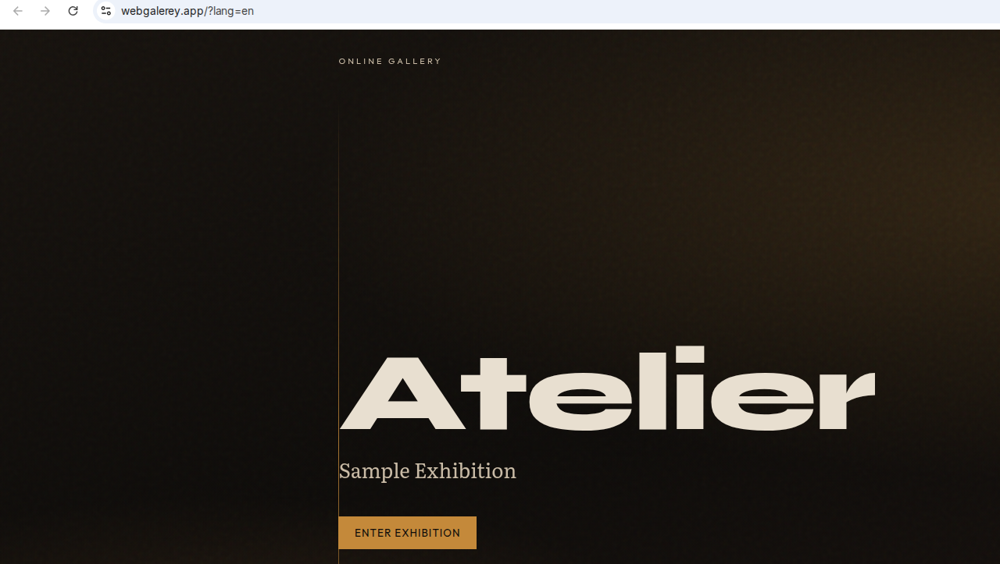
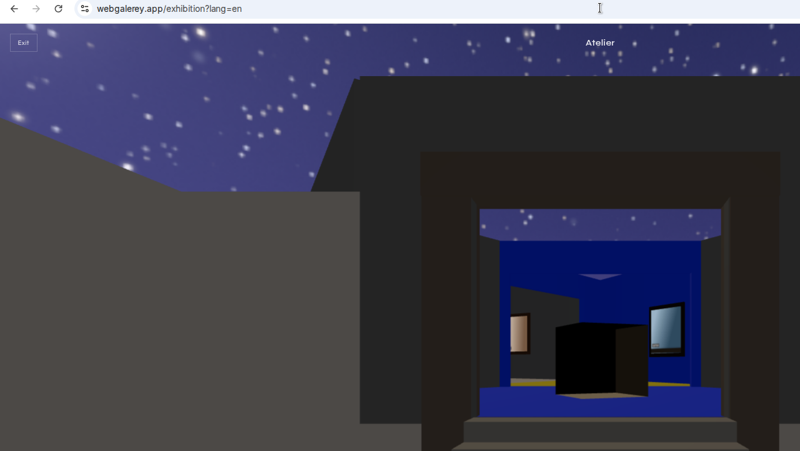
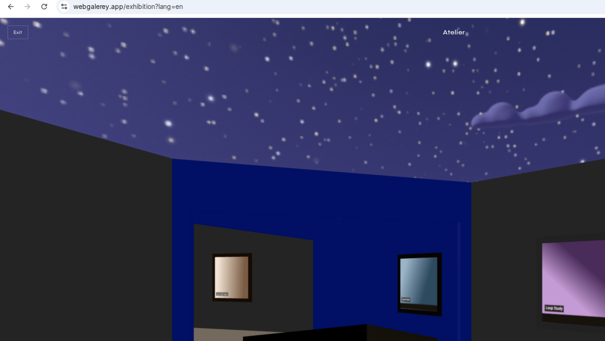

# Web Art Gallery + Exhibition Site

Public landing site, Google-allowlist admin CMS, catalog API (Vercel Blob), and a Three.js WebGL walkable exhibition.

**Live:** [https://webgalerey.app](https://webgalerey.app)

## Screenshots







## Features

- **Three.js exhibition** (`/exhibition`) — first-person walk through rooms defined by the admin layout; paintings, sculptures, booklet pedestal, open sky.
- **Admin Place as source of truth** — 2D schematic editor (`/admin/preview` and layout APIs) drives room geometry, wall placements, and catalog publish; gallery uses the same layout formulas.
- **Photon presence** — anonymous Realtime room (free 20 CCU); remote visitors appear as floating wisp avatars. When slots are full, a FIFO queue overlay (Upstash Redis) offers wait position or **Enter offline** solo play. Without Photon/Redis env, exhibition runs solo.
- **Landing + CMS** — poster landing, multi-locale bio (EN/RU/UK/HE), artwork CRUD, media upload to Blob, draft/live catalog publish.

## Repo layout

| Path | Purpose |
|------|---------|
| `web/` | Next.js App Router (landing, admin, API, exhibition) |
| `docs/screenshots/` | Production screenshots for this README |
| `Exibition/` | Optional Unity Editor project (not used by the web product) |

## Local development

```bash
cd web
cp .env.example .env.local
# fill AUTH_* and ADMIN_EMAILS (Blob token optional)
npm install
npm run dev
```

Open [http://localhost:3000](http://localhost:3000).

Without `BLOB_READ_WRITE_TOKEN`, catalog and media are stored under `web/.data/` (gitignored).

### Environment variables

| Variable | Required | Description |
|----------|----------|-------------|
| `AUTH_SECRET` | yes | Auth.js session secret |
| `AUTH_GOOGLE_ID` | yes (admin) | Google OAuth client ID |
| `AUTH_GOOGLE_SECRET` | yes (admin) | Google OAuth client secret |
| `GOOGLE_OAUTH_CLIENT_ID` | optional | Preferred Google OAuth client ID (overrides `AUTH_GOOGLE_ID`) |
| `GOOGLE_OAUTH_CLIENT_SECRET` | optional | Preferred Google OAuth secret (overrides `AUTH_GOOGLE_SECRET`) |
| `ADMIN_EMAILS` | yes (admin) | Comma-separated allowlist, case-insensitive |
| `BLOB_READ_WRITE_TOKEN` | prod | Vercel Blob read/write token |
| `CATALOG_SIGNING_SECRET` | recommended | Signs draft preview tokens (falls back to `AUTH_SECRET`) |
| `AUTH_URL` | prod | Public site URL for Auth.js |
| `PHOTON_APP_ID` | presence | Photon Realtime AppId (free 20 CCU); omit → solo exhibition. Served to the browser via `GET /api/presence/config` |
| `PHOTON_REGION` | presence | Photon region (default `eu`) |
| `UPSTASH_REDIS_REST_URL` | presence (prod) | Upstash Redis REST URL for the 20-slot gate + FIFO queue |
| `UPSTASH_REDIS_REST_TOKEN` | presence (prod) | Upstash Redis REST token |

### Key routes

| Route | Description |
|-------|-------------|
| `/` | Landing poster + Enter exhibition |
| `/bio` | Bio / CV from settings |
| `/exhibition` | Three.js WebGL gallery |
| `/admin/login` | Google OAuth |
| `/admin` | Dashboard |
| `/admin/artworks` | Artwork CRUD, reorder, publish, **Publish catalog** |
| `/admin/settings` | Poster, Instagram, email, bio (EN/RU/UK/HE) |
| `/admin/preview` | 2D schematic + draft iframe |
| `GET /api/catalog?catalog=live\|draft` | Catalog JSON (`draft` needs admin session or `token`) |

## Media limits

| Asset | Limit | Output |
|-------|-------|--------|
| Image upload | 8 MB raw | wall ≤1024px WebP, full ≤2048px WebP |
| Video upload | 80 MB | MP4 H.264; poster still on wall |
| Catalog | small JSON | `catalog-live.json` + `catalog-draft.json`; publish writes `catalog-v{n}.json` |

Uploads use a server-issued Blob token (direct client → Blob). Locally, multipart upload writes into `web/.data/`.

## Room growth (shared)

```
slotPitch = 3.0m
marginEnds = 2.0m
L = marginEnds*2 + ceil(N/2)*slotPitch   # N=0 → L0 = 4m
```

Works alternate left/right long walls. Admin schematic and Three.js gallery use the same formula.

## Deploy (Vercel)

1. Set **Root Directory** to `web`.
2. Add the env vars above.
3. Deploy with **Root Directory `web`** (Vercel dashboard). Config lives in `web/vercel.json` only — no repo-root `vercel.json` (root `--prefix web` commands break GitHub previews when Root Directory is `web`).

```bash
cd web && npm run build
```
